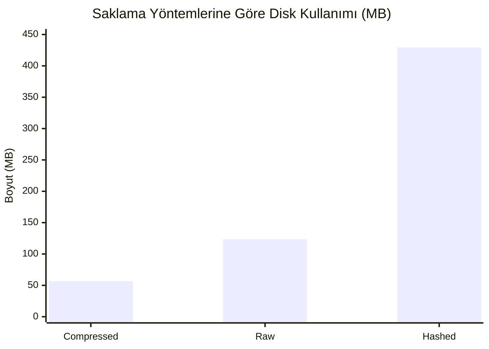
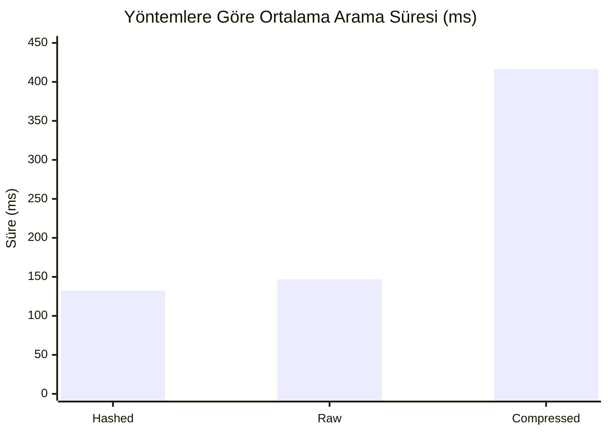

# Büyük Parola Veri Setlerinin Farklı Formatlarda Saklanması ve Arama Performansının Analizi

**Ders:** Dosya Organizasyonu
**Proje Konusu:** Veri Ön İşleme, Saklama Yöntemleri ve Arama Performansı Analizi
**Hazırlayan:** Ali Rıza Öztürk
**Tarih:** 18.06.2026

---

## Özet (Abstract)

Bu projede, [SecLists](https://github.com/danielmiessler/SecLists) deposundan alınan **37 ham parola listesi** birleştirilip temizlenerek **13.644.552 benzersiz parola** (~123,5 MB) elde edilmiş; bu veri üç farklı yöntemle (düz metin / *Raw*, kriptografik özet / *Hashed* (MD5), sıkıştırılmış / *Compressed* (gzip)) saklanmış ve aralarındaki **disk–zaman–güvenlik ödünleşimi** ölçülmüştür. Tekrarlı kayıtlar, ortalama $O(1)$ karmaşıklıklı bir **Hash Set** ile $O(n)$ zamanda temizlenmiştir. **100 rastgele parola** üzerinde doğrusal arama yapılarak ortalama/maksimum süre, CPU ve bellek kullanımı; Linux'a özgü `clock_gettime`, `getrusage` ve `/proc` arayüzleriyle ölçülmüştür. Bulgular; *Compressed* yöntemin diskte %54 tasarruf sağladığını ancak aramayı ~2,8 kat yavaşlattığını, *Hashed* yöntemin ise diski ~3,5 kat şişirmesine rağmen arama hızında kazanç sağlamadığını göstermektedir. Temel çıkarım, asıl performans kazanımının saklama biçiminden değil, verinin **indekslenmesinden** geleceğidir.

---

## İçindekiler

0. [Özet (Abstract)](#özet-abstract)
1. [Giriş](#1-giriş)
2. [Kullanılan Araçlar ve Teknolojiler](#2-kullanılan-araçlar-ve-teknolojiler)
3. [Proje Tasarımı](#3-proje-tasarımı)
4. [Veri Ön İşleme (Preprocessing)](#4-veri-ön-i̇şleme-preprocessing)
5. [Veri Saklama Yöntemleri (Storage)](#5-veri-saklama-yöntemleri-storage)
6. [Arama ve Performans Ölçümleri](#6-arama-ve-performans-ölçümleri)
7. [Sonuçlar ve Değerlendirme](#7-sonuçlar-ve-değerlendirme)
8. [Referanslar](#8-referanslar)

---

## 1. Giriş

Bu projenin amacı, gerçek dünyadan elde edilmiş **büyük ölçekli bir parola veri setini** alıp; bu veriyi temizlemek (ön işleme), üç farklı yöntemle disk üzerinde saklamak ve ardından bu farklı saklama biçimleri üzerinde arama yaparak **disk kullanımı ile arama süresi arasındaki maliyet ilişkisini** ölçmektir.

Modern bilişim sistemlerinde veri büyüklüğü hızla artmaktadır. Aynı veri; düz metin (plain text), kriptografik özet (hash) veya sıkıştırılmış (compressed) biçimde tutulabilir. Bu biçimlerin her birinin **disk maliyeti**, **erişim/arama süresi**, **CPU yükü** ve **güvenlik** açısından farklı avantaj ve dezavantajları vardır. Örneğin:

- **Düz metin** en hızlı erişimi sağlar ancak diskte fazla yer kaplar ve hassas veriyi (parola gibi) açıkta bırakır.
- **Hash'lenmiş saklama**, veriyi tek yönlü olarak gizleyerek güvenlik sağlar; fakat sabit uzunluklu özetler nedeniyle disk maliyetini artırabilir.
- **Sıkıştırılmış saklama** diskten ciddi tasarruf sağlar; ancak her erişimde verinin açılması (decompression) gerektiğinden CPU ve zaman maliyeti getirir.

Bu projede kapsam olarak, [SecLists](https://github.com/danielmiessler/SecLists) deposundan alınan **37 adet parola listesi** birleştirilip temizlenmiş, sonuçta **13.644.552 benzersiz parola** (yaklaşık 123,5 MB) elde edilmiştir. Bu veri üç ayrı yapıda saklanmış ve **100 rastgele parola** üzerinden arama testleri yapılarak yukarıdaki maliyet dengeleri (trade-off) somut sayılarla ortaya konmuştur.

Projenin temel motivasyonu şu sorulara cevap aramaktır:

> *Aynı veriyi farklı formatlarda saklamanın diske ve arama süresine etkisi nedir? Hangi yöntem hangi senaryoda tercih edilmelidir?*

---

## 2. Kullanılan Araçlar ve Teknolojiler

| Teknoloji | Sürüm / Detay | Kullanım Amacı |
|-----------|---------------|----------------|
| **C (C11 standardı)** | `-std=c11` | Tüm modüllerin geliştirildiği ana programlama dili |
| **GCC** | 13.3.0 (Ubuntu) | Derleyici (`-Wall -Wextra -O2` ile optimize ve uyarı denetimli derleme) |
| **WSL2 / Ubuntu 24.04** | Linux çekirdeği 6.6 | Geliştirme ve test ortamı (Linux'a özgü API'ler için) |
| **OpenSSL (libcrypto)** | 3.x | MD5 özetlerinin hesaplanması (`-lcrypto`) |
| **zlib** | 1.x | Verinin gzip formatında sıkıştırılması/açılması (`-lz`) |
| **GNU Make** | Makefile | Modüler derleme otomasyonu (her aşama için ayrı hedef) |

**Neden C dili?** Dosya organizasyonu dersinin doğası gereği, bellek ve dosya seviyesinde düşük seviyeli (low-level) kontrol gereklidir. C; işaretçiler, manuel bellek yönetimi ve doğrudan sistem çağrıları (system calls) sayesinde performans ölçümlerinin hassas yapılmasına imkân tanır.

**Neden Linux/WSL?** Performans metrikleri için kullanılan `getrusage()`, `clock_gettime()` ve `/proc` sanal dosya sistemi Linux'a özgüdür. Windows üzerinde geliştirme yapılırken, gerçek Linux davranışını birebir test edebilmek için **WSL2 (Windows Subsystem for Linux)** kullanılmıştır. Tüm derleme ve ölçümler bu ortamda gerçekleştirilmiştir.

---

## 3. Proje Tasarımı

### 3.1. Klasör Yapısı

Proje, verinin yaşam döngüsünü (ham veri → temizlenmiş veri → saklanmış veri → sonuçlar) yansıtacak şekilde modüler bir klasör hiyerarşisiyle tasarlanmıştır:

```
proje/
├── RawData/      → Ham SecLists parola listeleri (37 dosya, ~190 MB)
├── Processed/    → Temizlenmiş ve birleştirilmiş veri (passwords.txt)
├── Storage/      → Üç farklı saklama yöntemi
│   ├── Raw/         (düz metin kopya)
│   ├── Hashed/      (MD5 özetleri)
│   └── Compressed/  (gzip ile sıkıştırılmış)
├── Code/         → Tüm kaynak kodlar ve Makefile
├── Results/      → performance_results.txt (ölçüm raporu)
└── Report/       → Bu rapor
```

Bu ayrım, **ham veriye asla dokunulmaması** ilkesini güvence altına alır: Aşama 1'den sonra tüm işlemler yalnızca `Processed/passwords.txt` üzerinden yapılır.

### 3.2. Kod Modülleri ve Görevleri

Proje, "tek sorumluluk ilkesi"ne (single responsibility) uygun olarak ayrı `.c`/`.h` modüllerine bölünmüştür. Her aşamanın kendi `main` dosyası vardır:

| Modül | Görevi |
|-------|--------|
| **preprocess.c / .h** | Ham dosyaları okur; boş satırları ve tekrarları (Hash Set ile) temizler; birleştirilmiş benzersiz veriyi üretir. |
| **storage.c / .h** | Temizlenmiş veriyi *Raw* (düz metin kopya) ve *Hashed* (MD5) olarak kaydeder. |
| **compression.c / .h** | Veriyi zlib kullanarak gzip formatında sıkıştırır (*Compressed*). |
| **search.c / .h** | Rastgele arama setini oluşturur (reservoir sampling) ve üç yapıda (Raw/Hashed/Compressed) arama yapar. |
| **utils.c / .h** | Performans ölçüm yardımcıları: zaman (`clock_gettime`), CPU (`getrusage`), bellek (`/proc`). |
| **main.c** | Aşama 3 akışı: arama testleri + performans raporu. |
| **main_store.c** | Aşama 2 akışı: saklama yöntemlerinin üretilmesi. |
| **main_pre.c** | Aşama 1 akışı: ön işleme. |

Bu modülerlik sayesinde her aşama bağımsız olarak derlenebilir, test edilebilir ve bakımı yapılabilir. Derleme `Makefile` ile yönetilir; `preprocess`, `storage` ve `search` olmak üzere üç ayrı çalıştırılabilir dosya üretilir.

---

## 4. Veri Ön İşleme (Preprocessing)

### 4.1. Amaç ve Girdi

Ham veri seti, SecLists'ten alınmış 37 farklı parola listesinden oluşur. Bu dosyaların ortak sorunları şunlardır:

- **Tekrarlı parolalar:** Farklı listeler aynı popüler parolaları (`123456`, `password` vb.) içerir.
- **Boş satırlar:** Dosya sonlarında veya aralarda boş satırlar bulunabilir.
- **Farklı formatlar:** Çoğu dosya satır başına bir parola içerirken, bir dosya (`four-digit-pin-...csv`) `parola,frekans` biçimindedir.
- **Windows satır sonları (CRLF):** Dosyalar `\r\n` ile sonlanır.

### 4.2. Tekrar Temizliğinde Hash Set ve $O(1)$ Karmaşıklık

Projenin en kritik tasarım kararı, tekrar temizliğinin nasıl yapılacağıdır. Naif yaklaşım, her parolayı diğer tüm parolalarla karşılaştırmaktır; bu **$O(n^2)$** karmaşıklığa sahiptir. 18 milyondan fazla satır için bu yaklaşım pratikte uygulanamaz (kabaca $10^{14}$ işlem).

Bunun yerine projede **Hash Set (karma kümesi)** veri yapısı kullanılmıştır. Her okunan parola için:

1. Parolanın **djb2** karma fonksiyonu ile bir hash değeri hesaplanır.
2. Bu hash, bir kova (bucket) dizisinde konumu belirler.
3. Aynı kovadaki elemanlar **zincirleme (separate chaining)** ile bağlı liste olarak tutulur.
4. Parola kümede yoksa eklenir (benzersiz), varsa atlanır (tekrar).

Ekleme ve arama işlemleri **ortalama $O(1)$** zamanda gerçekleşir. Çakışmaların artmasını önlemek için, kümenin **doluluk oranı %75'i geçtiğinde kova sayısı otomatik olarak iki katına çıkarılır (rehashing)**. Böylece toplam temizleme işlemi $O(n)$ zamanda tamamlanır.

```c
/* djb2 — basit ve hızlı bir string hash fonksiyonu */
static unsigned long hash_str(const char *s) {
    unsigned long h = 5381;
    int c;
    while ((c = (unsigned char)*s++))
        h = ((h << 5) + h) + c;   /* h * 33 + c */
    return h;
}
```

### 4.3. İşlem Akışı

Her dosya satır satır okunur ve şu adımlardan geçer:
1. `.csv` dosyasında virgülden sonraki frekans bilgisi atılır (yalnızca parola alınır).
2. Satır sonundaki `\r` ve `\n` karakterleri temizlenir (CRLF/LF uyumu).
3. Satır boşsa atlanır.
4. Hash Set'e eklenmeye çalışılır; yalnızca **yeni** olanlar çıktı dosyasına yazılır.

### 4.4. Karşılaşılan Sorunlar ve Çözümleri

Geliştirme sırasında üç önemli teknik sorun tespit edilip giderilmiştir:

- **Taşınabilirlik (`getline`):** İlk sürümde kullanılan POSIX `getline()` fonksiyonu bazı ortamlarda tanımlı olmadığından, kendi taşınabilir satır okuyucumuz (`read_line`) yazılmıştır.
- **Metin modu / `0x1A` sorunu:** Dosyalar metin modunda (`"r"`) açıldığında, veride bulunan bir `0x1A` (Ctrl-Z) baytı dosya sonu olarak yorumlanıp okumayı erken kesiyordu. Dosyalar **ikili (binary) modda** (`"rb"`/`"wb"`) açılarak hem bu erken kesilme hem de çıktıdaki istenmeyen CRLF dönüşümü giderilmiştir.
- **Sayaç başlatma hatası:** İstatistik sayaçlarının sıfırlanmaması nedeniyle hatalı değerler üretiliyordu; sayaçların her durumda sıfırlanması sağlanmıştır.

### 4.5. Ön İşleme Sonuçları

| Metrik | Değer |
|--------|------:|
| İşlenen dosya sayısı | 37 |
| Okunan toplam satır | 18.360.447 |
| Temizlenen boş satır | 8 |
| Atlanan tekrar (duplicate) | 4.715.887 |
| **Yazılan benzersiz parola** | **13.644.552** |
| Çıktı boyutu | 129.561.974 bayt (~123,56 MB) |

Tekrar oranının yaklaşık **%25,7** olması (18,3M → 13,6M), birden fazla listenin ciddi ölçüde örtüştüğünü göstermektedir.

---

## 5. Veri Saklama Yöntemleri (Storage)

Temizlenmiş `passwords.txt` dosyası, üç farklı yöntemle `Storage/` altına kaydedilmiştir. **Bu aşamadaki tüm okumalar yalnızca `Processed/passwords.txt` üzerinden yapılmıştır.**

### 5.1. Raw Storage (Düz Metin)

Veri hiçbir değişikliğe uğramadan, 64 KB'lik bloklar halinde ikili kopyalama ile `Storage/Raw/passwords.txt` dosyasına yazılır. Bu dosya, diğer yöntemlerin doğruluğunu karşılaştırmak için bir **referans (kontrol)** görevi görür. `cmp` aracıyla kaynakla **birebir aynı** olduğu doğrulanmıştır.

### 5.2. Hashed Storage (MD5)

Her parolanın düz metni yerine, **OpenSSL EVP arayüzü** kullanılarak hesaplanan **MD5 özeti** (32 karakterlik onaltılık metin) satır satır kaydedilir. EVP arayüzü (`EVP_Digest`, `EVP_md5`) tercih edilmiştir; bu, OpenSSL 1.1 ve 3.x ile uyumludur ve kullanımdan kaldırma (deprecation) uyarısı üretmez.

```
123456  →  e10adc3949ba59abbe56e057f20f883e
```

Bu dönüşüm **tek yönlüdür**: hash'ten parolaya geri dönülemez. Doğruluk, `123456` parolasının MD5'inin `md5sum` aracının çıktısıyla eşleşmesiyle teyit edilmiştir.

### 5.3. Compressed Storage (zlib / gzip)

Veri, zlib'in akış (streaming) fonksiyonlarıyla (`gzopen`, `gzwrite`, `gzclose`) **gzip formatında** sıkıştırılarak `Storage/Compressed/passwords.txt.gz` dosyasına yazılır. Sıkıştırma seviyesi 6 (varsayılan denge) kullanılmıştır. Veri 64 KB'lik parçalar halinde işlendiğinden, 123 MB'lik dosya bile belleğe topluca yüklenmez. Üretilen dosya standart `gunzip` aracıyla açılabilir ve açıldığında orijinaliyle **birebir eşittir** (`gunzip -c | cmp` ile doğrulanmıştır).

### 5.4. Saklama Boyutları

| Yöntem | Dosya | Boyut |
|--------|-------|------:|
| Raw | `Storage/Raw/passwords.txt` | 123,56 MB |
| Hashed | `Storage/Hashed/passwords.md5.txt` | 429,41 MB |
| Compressed | `Storage/Compressed/passwords.txt.gz` | 56,67 MB |



Grafikten de görüldüğü gibi, *Compressed* en az yeri kaplarken *Hashed* yöntem ham veriye kıyasla diski belirgin biçimde şişirmektedir.

---

## 6. Arama ve Performans Ölçümleri

### 6.1. Arama Setinin Oluşturulması

Testlerin tutarlı olması için `Processed/passwords.txt` dosyasından **100 rastgele parola** seçilir. Tüm dosya (13,6 milyon satır) belleğe sığamayacağından, **reservoir sampling (rezervuar örnekleme)** algoritması kullanılmıştır. Bu algoritma, dosyayı **tek geçişte** ve sabit bellekte tararken her satıra eşit seçilme olasılığı verir:

- İlk 100 satır doğrudan alınır.
- Sonraki her $i$. satır, $100/(i+1)$ olasılıkla mevcut seçilenlerden birinin yerine konur.

Seçilen 100 parola, tanım gereği veride mevcut olduğundan üç yöntemde de **100/100 bulunması** beklenir (ve gözlemlenmiştir).

### 6.2. Arama Yöntemleri

Her üç yöntem de **doğrusal (linear) arama** yapar; yani eşleşme bulunana kadar dosya satır satır taranır (`break` ile erken çıkış):

- **Raw arama:** Düz metin dosyasında doğrudan `strcmp` ile karşılaştırma.
- **Hashed arama:** Önce aranan parolanın **anlık MD5'i hesaplanır**, ardından hash dosyasında bu 32 karakterlik değer aranır.
- **Compressed arama:** `.gz` dosyası `gzgets` ile **okunurken aynı anda açılır** (decompress) ve metin karşılaştırması yapılır.

### 6.3. Metriklerin Ölçüm Yöntemi (utils modülü)

| Metrik | Ölçüm Yöntemi |
|--------|---------------|
| **Ortalama / Maksimum Süre** | Her arama, `clock_gettime(CLOCK_MONOTONIC)` ile mikrosaniye hassasiyetinde tek tek zamanlanır. 100 ölçümün ortalaması ve en büyüğü (worst-case) alınır. |
| **CPU Kullanımı (%)** | `getrusage()` ile sürecin kullanıcı+çekirdek CPU zamanı alınır. $CPU\% = \dfrac{\text{CPU zamanı}}{\text{geçen gerçek süre}} \times 100$ formülüyle hesaplanır. |
| **Bellek (RSS)** | Anlık yerleşik bellek `/proc/self/statm` üzerinden; tepe (peak) bellek `getrusage().ru_maxrss` üzerinden ölçülür. |
| **Decompression Süresi** | Yalnızca Compressed için; `.gz` dosyası baştan sona açılır (arama yapılmadan). Ölçüm 3 kez tekrarlanıp ortalaması alınarak gürültü azaltılır. |

Ölçümlerin doğruluğu için veri, WSL'in yerel ext4 dosya sistemine kopyalanarak çalıştırılmıştır; böylece Windows/9p dosya sistemi köprüsünün getireceği yanıltıcı I/O gecikmeleri elenmiştir.

---

## 7. Sonuçlar ve Değerlendirme

### 7.1. Nihai Performans Tablosu

> Aşağıdaki sonuçlar 100 rastgele parola ile yapılan aramaların ölçümüdür (örnekleme seed = 1781818109). Tüm yöntemlerde **100/100** parola başarıyla bulunmuştur.

| Yöntem | Disk (MB) | Ort. Süre (ms) | Maks. Süre (ms) | CPU % | Bellek (MB) | Bulunan |
|--------|----------:|---------------:|----------------:|------:|------------:|--------:|
| **Raw** | 123,56 | 146,86 | 318,96 | 100 | 2,88 | 100/100 |
| **Hashed** | 429,41 | 132,25 | 277,32 | 100 | 5,12 | 100/100 |
| **Compressed** | 56,67 | 416,39 | 858,42 | 100 | 5,12 | 100/100 |

**Ek metrikler:**
- Orijinal veri boyutu: **123,56 MB**
- Sıkıştırma oranı: **%54,1 kazanç (2,18× daha küçük)**
- Tam açma (decompression) süresi: **579,76 ms** (129.561.974 bayt)
- Süreç tepe bellek (peak RSS): **5,25 MB**



Grafik, *Raw* ve *Hashed* yöntemlerinin neredeyse aynı sürede çalıştığını; *Compressed* yöntemin ise açma (decompression) maliyeti nedeniyle belirgin biçimde daha yavaş olduğunu açıkça ortaya koymaktadır.

### 7.2. Bulguların Değerlendirilmesi

**a) Disk Kullanımı — en belirgin fark:**
- **Compressed** açık ara en verimlidir; ham veriyi yarıdan fazla küçültür (123,56 → 56,67 MB).
- **Hashed** ise ham veriden **~3,5 kat daha büyüktür** (429,41 MB). Bunun nedeni, uzunluğu ne olursa olsun her parolanın sabit 32 karakterlik MD5'e dönüşmesidir. Ortalama parola ~8–9 karakterken, hash 32 karakter olduğundan dosya genişler.

**b) Arama Hızı:**
- **Compressed en yavaş yöntemdir** (~416 ms; Raw'ın ~2,8 katı). Bu beklenen bir sonuçtur: her aramada veri önce açılmak (decompress) zorundadır. Tek başına tam açmanın ~580 ms sürmesi bu maliyeti doğrular; aramada erken çıkış olduğundan ortalama bunun bir miktar altında kalır.
- **Raw ve Hashed neredeyse aynı hızdadır** (~147 ms ve ~132 ms). Bu, projenin en öğretici bulgusudur: Hashed dosya 3,5 kat büyük olmasına rağmen **arama hızında bir kazanç sağlamaz**. Çünkü hash dosyası ham dosyayla **satır hizalıdır** ($i$. satır = $i$. parolanın MD5'i) ve arama her ikisinde de **doğrusaldır**; eşleşme aynı satır indeksinde bulunur. Aradaki küçük fark ölçüm gürültüsünden ibarettir.
- **Maksimum süreler**, eşleşmenin dosyanın sonlarına denk geldiği "en kötü durum" aramalarını temsil eder ve ortalamanın yaklaşık iki katıdır.

**c) CPU ve Bellek:**
- **CPU ≈ %100:** İşlem tek çekirdekte çalışır ve CPU + (önbellekli) I/O bağımlıdır.
- **Bellek çok düşüktür (2,88–5,25 MB):** Dosyalar belleğe topluca yüklenmez, satır satır akış (streaming) ile işlenir. Compressed ve Hashed'in bir miktar fazla kullanması zlib tamponları ve daha uzun satırlardan kaynaklanır.

### 7.3. Trade-off (Ödünleşim) Analizi

| Yöntem | Disk | Arama Hızı | Veri Geri Alınabilir mi? | Tipik Kullanım Senaryosu |
|--------|------|-----------|--------------------------|--------------------------|
| **Raw** | Orta | Hızlı | ✅ Evet | Hız öncelikli, veriye sık erişim |
| **Hashed** | ❌ En kötü (3,5×) | Raw ile aynı | ❌ Hayır (tek yönlü) | Güvenlik (düz parola saklanmaz) |
| **Compressed** | ✅ En iyi | ❌ En yavaş | ✅ Evet | Arşivleme, nadir erişilen büyük veri |

### 7.4. Doğrusal (Linear) Aramanın Etkisi ve Genel Sonuç

Bu projedeki en önemli teorik çıkarım, **arama algoritmasının seçilen saklama yapısından bağımsız olarak performansı belirlediğidir.** Her üç yöntem de $O(n)$ karmaşıklıkta doğrusal arama kullandığından:

- Hash'leme, bir saklama biçimi olarak **arama hızına katkı sağlamamış**, yalnızca disk maliyetini artırmıştır. Hash'lemenin gerçek değeri burada **güvenliktir**, performans değil.
- Sıkıştırma, diskte büyük kazanç sağlarken arama hızını ek CPU maliyetiyle düşürmüştür.

Buradan çıkan kritik ders şudur: **Asıl performans kazanımı, saklama biçiminden değil, veriyi indekslemekten gelir.** Eğer hash değerleri doğrusal bir liste yerine bir **hash tablosunda** tutulsaydı, arama $O(1)$'e; sıralı veri üzerinde **ikili arama (binary search)** yapılsaydı $O(\log n)$'e inerdi. Bu, projenin doğal bir sonraki adımı olarak önerilmektedir.

**Özetle:** Hız ve sık erişim öncelikliyse *Raw*, disk tasarrufu ve arşivleme öncelikliyse *Compressed*, güvenlik (parolanın gizlenmesi) öncelikliyse *Hashed* tercih edilmelidir. "En iyi" yöntem yoktur; seçim, uygulamanın **disk–zaman–güvenlik** önceliklerine bağlıdır.

---

## 8. Referanslar

1. **SecLists** — Daniel Miessler, Güvenlik test listeleri koleksiyonu (parola veri setinin kaynağı).
   <https://github.com/danielmiessler/SecLists>

2. **OpenSSL** — Kriptografi ve TLS kütüphanesi; MD5 özetlerinin hesaplanmasında kullanılmıştır.
   <https://www.openssl.org/> — EVP API dokümantasyonu: <https://docs.openssl.org/master/man3/EVP_DigestInit/>

3. **zlib** — Jean-loup Gailly ve Mark Adler, genel amaçlı sıkıştırma kütüphanesi.
   <https://www.zlib.net/> — Kılavuz: <https://www.zlib.net/manual.html>

4. **GNU Make** — Derleme otomasyon aracı.
   <https://www.gnu.org/software/make/manual/>

5. **GCC (GNU Compiler Collection)** — <https://gcc.gnu.org/>

6. **WSL (Windows Subsystem for Linux)** — Microsoft resmi dokümantasyonu.
   <https://learn.microsoft.com/en-us/windows/wsl/>

7. **getrusage(2), clock_gettime(2), proc(5)** — Linux Programmer's Manual (performans ölçüm API'leri).
   <https://man7.org/linux/man-pages/>

8. Bentley, J. & Knuth, D. E. — *Reservoir Sampling* (Algorithm R), rastgele örnekleme yöntemi.
